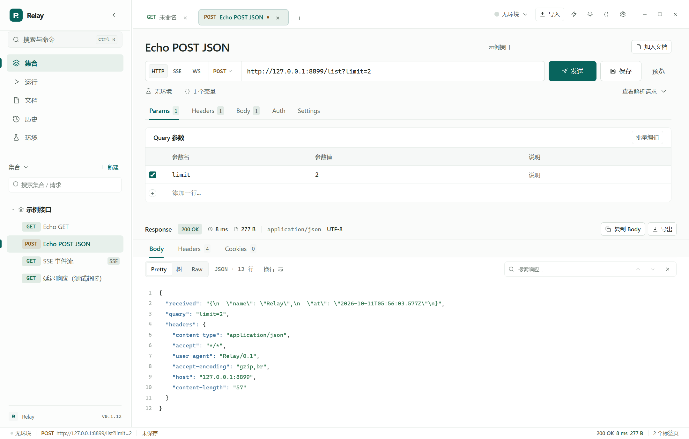
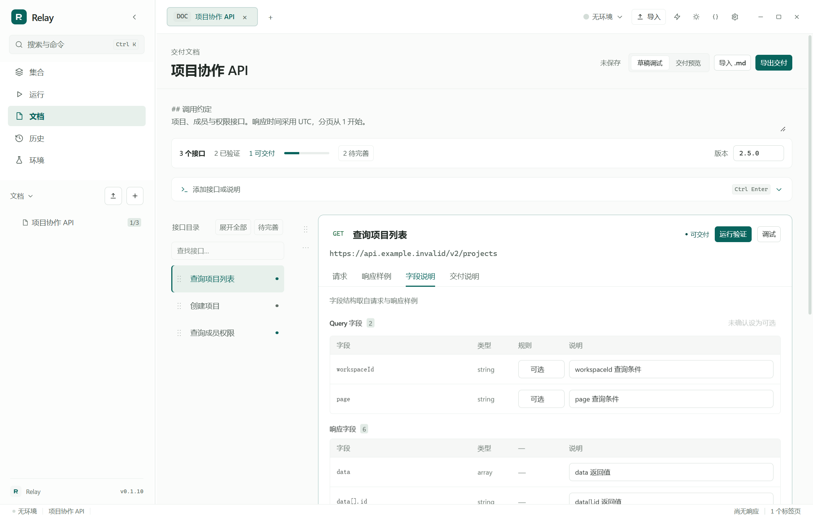
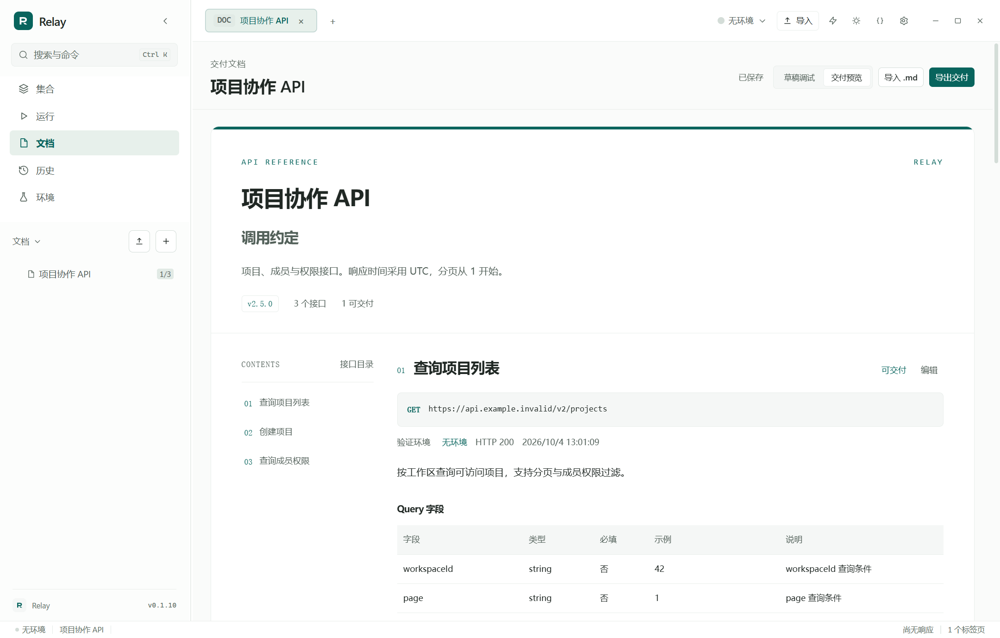

<div align="center">

# Relay

**本地优先的接口工作台：调试 HTTP / SSE / WebSocket，并把结果直接写成交付文档。**

不需要账号 · 不需要联网也能用 · 数据全在本机 JSON 文件里

**Windows 10 / 11 x64** · **Tauri 2 + Rust** · **MIT**

[下载](#安装) · [快速上手](#快速上手) · [功能](#功能) · [让 AI 编写交付文档](#让-ai-编写交付文档) · [从源码构建](docs/development.md) · [更新记录](docs/releases/v0.1.17.md)



</div>

---

Relay 将接口调试与交付文档放在同一个工作台：**粘贴 cURL → 运行验证 → 补字段说明 → 导出 Markdown / HTML / OpenAPI 3.0**。请求或环境变化后会提示重新验证，交付稿保留当次执行的证据。

## 安装

在本仓库的 Releases 中下载 **`Relay_0.1.17_x64-setup.exe`**（3.3 MB），双击安装。

| | |
| --- | --- |
| 系统 | Windows 10 / 11，x64 |
| 运行时 | Microsoft Edge WebView2 Runtime（Win 10/11 通常已内置；缺失时安装器会引导安装） |
| 默认安装位置 | `%LOCALAPPDATA%\Relay`，可自选 |
| 数据位置 | 程序旁可写的 `data` 目录；不可写时回退到用户本地应用数据目录 |
| 安装包 SHA-256 | `4F86E5C79C52C5B7F582803C9AAA00C45314D27AF9B0A082B11561FEFC801FFF`（3,491,607 字节） |

校验下载文件：

```powershell
Get-FileHash -LiteralPath .\Relay_0.1.17_x64-setup.exe -Algorithm SHA256
```

想要免安装版？Release 附件是 NSIS 安装包；不需要安装的话，按[从源码构建](#从源码构建)跑 `.\build.ps1 --portable` 会产出单文件 `dist\Relay.exe`，拷到任意 Windows 10/11 x64 机器即可运行。

> 卸载时工作区数据会保留。从旧的免安装版本迁移，只需在安装版里指向原来的 `data` 目录。

## 快速上手

1. **发第一个请求** — 新建 HTTP 请求，填方法和 URL（或直接粘贴一段 cURL），按 `Ctrl+Enter`。
2. **存进集合** — 按 `Ctrl+S`。请求和文件夹可以拖拽排序。
3. **用变量** — 在「环境」里加一个 `baseUrl`，URL 写 `{{baseUrl}}/v1/projects`。在支持变量的请求输入框里打一个 `{` 会弹出变量列表，继续输入可筛选，`Enter` 或 `Tab` 选中；列表底部可以直接新建变量。
4. **变成文档** — 点「加入文档」，或在文档里直接粘贴 cURL，补上字段说明后导出。

## 功能

| 区域 | 支持内容 |
| --- | --- |
| **HTTP 调试** | Query、Headers、Body、鉴权、文件上传；超时、重定向、代理、证书校验与 Cookie 设置 |
| **SSE** | 持续接收事件、选择流格式、累计统计；暂停跟随、新消息提示、清空显示 |
| **WebSocket** | 连接与消息收发，文本与 Base64 二进制；握手预览、子协议与认证配置、消息记录 |
| **集合与环境** | 请求与文件夹管理；环境 / 集合 / 全局三级变量，输入 `{` 触发补全与新建 |
| **代码编辑器** | 语法高亮、行号、自动配对与缩进、字面量与变量补全、错误定位、格式化 / 压缩、搜索 |
| **响应查看** | Pretty、树形、Raw 三种视图；响应内搜索、Headers / Cookies、复制与导出 |
| **请求预览** | 查看变量替换后的 URL、Headers、Body、鉴权与变量来源；保留上次发送快照 |
| **交付文档** | cURL 草稿、关联请求、运行验证、字段说明、验证过期提示，导出 Markdown / HTML / OpenAPI 3.0 |
| **检查与提取** | 状态码、JSON 路径 / 值 / 类型、耗时检查；从 JSON 或响应头提取运行变量，查看每项预期与实际 |
| **运行计划** | 集合、文件夹或单个请求组成串行步骤；提取 token 后传给后续请求，失败停止、间隔、定时执行，逐条查看请求、响应与检查证据。支持 **CSV 数据文件**：第一行是列名，每行跑一遍计划，列名写成 `{{列名}}` 即被当轮的值替换（行值覆盖环境，提取器覆盖行值），结果随计划持久化，定时运行不依赖原文件 |
| **导入导出** | cURL、OpenAPI 3 JSON、HAR 导入；可选请求、改名、排除敏感头和参数；集合 JSON 导出、Markdown 文档导入 |
| **AI 工作流** | 本地认证 API，自带 **MCP 服务器**（`/mcp`）与通用 skill；三档权限、主机白名单逐跳生效；有界索引 / 搜索 / 执行前干跑预览 / 批量提交让 AI 一轮就收敛；AI 创建请求、配置检查、真实验证、补写字段说明，用户在应用内审阅并交付 |
| **外观** | 薄荷、晴空、雾紫、桃杏、奶油、石板六套配色，浅色 / 深色，多档字号与减少动态效果 |

已知边界：定时计划只在应用运行时触发；SSE 与 WebSocket 长连接会在串行计划里跳过；文档的运行验证目前只支持 HTTP；CSV 数据文件上限 2000 行 / 50 列，且只能在本机界面上选择，不能通过 AI 接口设置。

登录取 token、业务检查和导入范围见[请求检查与变量链路](docs/request-checks.md)。提取变量默认只在本次计划生效；只有点击「写入环境」才长期保存。

## 从请求到交付

接口跑通以后，调试结果可以直接成为文档的一部分。

1. **粘贴 cURL** — 在文档里加入接口草稿，也可以关联集合中已保存的请求。
2. **运行验证** — 使用当前环境执行请求，保留验证时的请求快照与响应样例。
3. **补充约定** — 根据请求与响应生成的字段结构，填写说明、必填规则和业务约定。
4. **确认交付** — 查看待完善项，确认后导出 Markdown、HTML 或 OpenAPI 3.0 JSON。

关联请求或环境变更后，文档会提示验证过期，已有说明继续保留。响应样例只用于生成字段结构，**业务语义和必填规则由你确认**——这一步 Relay 不替你决定。

关联请求配置了检查时，文档验证也遵循这些规则。业务检查失败不会更新验证样例，也不能确认交付。




## 让 AI 编写交付文档

在右上角 **AI** 选择权限并开启本地连接，AI 工具就能操作正在运行的 Relay：创建请求、配置检查、真实验证、补写字段说明。验证证据来自实际执行，交付状态由用户在应用内确认。

接入方式有两种，共用同一个本机端口、同一份凭证、同一套限制——**装好 Relay 就是一个 MCP 服务器**，不需要额外安装或启动任何服务：

| 方式 | 端点 | 适合 |
| --- | --- | --- |
| 通用 skill | `POST /v1/command` | 支持 skill 或命令行的 AI 工具，随仓库提供 `relay-workflow` 与无依赖的 Python 客户端 |
| MCP | `POST /mcp` | 只认远程 MCP 服务器地址的客户端，直接粘贴连接面板复制的配置 |

边界由应用强制，而不是写在文档里劝 AI 别这么做的：

- **三档权限**——只读 / 可编辑 / 可执行，默认不含执行权。越权调用返回 `insufficient_scope` 并说明该申请哪一档；MCP 的 `tools/list` 更是只列出当前权限够得着的工具，只读连接根本看不到「发送请求」这个按钮。
- **主机白名单**——可执行连接必须点名允许的主机，请求真正发出前校验，**跟随跳转时逐跳重新校验**。白名单里的服务甩一个指向别处的 302，Relay 停在半路并把原因报回来，不会带着同一份凭证继续走。手动发送不受此限制。

读接口按"先给地图、再按需展开"设计，因为外部工具的上下文就是它的预算：`workspace.list` 默认只回每个集合的请求**数量**，`entity.find` 按名称或 URL 片段跨集合搜索，`limit` 一律有界并说明还剩多少。**`request.preview` 在执行之前把变量、鉴权、集合默认头解析成真正要上 wire 的样子回显出来（不发流量），并拿最近一次真实响应逐个校验 checks / extractors 里的 JSON path**——路径写错时会说清在哪一段断的、那一层有哪些键。一次 `{"commands":[...]}` 可提交最多 20 条命令，坏一条不挡其余。

连接步骤、命令行调用和完整边界见 [AI 工作流](docs/ai-workflow.md)。

## 数据与隐私

集合、环境、文档、历史记录与设置都是**本机的 JSON 文件**，没有账号、没有同步服务。

- 请求由发送、文档运行验证、已启用的运行计划或开启的 AI 连接执行命令触发；定时计划只在应用运行时执行。
- 在「设置 → 数据」中可查看或迁移数据目录，也可以指向已有目录。
- 卸载程序保留工作区数据。
- 请求显式保存，文档自动保存；文档标题旁显示保存状态，失败可重试。

列表排序、文档块增删与计划步骤操作支持会话内撤销；撤销历史不跨重启保留。

## 快捷键

| 快捷键 | 操作 |
| --- | --- |
| `Ctrl+K` | 搜索请求与命令 |
| `Ctrl+Enter` | 发送当前请求 / 运行当前接口 |
| `Ctrl+S` | 保存 |
| `Ctrl+W` | 关闭当前标签 |
| `Ctrl+Tab` | 切换标签 |
| `Ctrl+/` | 切换浅色 / 深色 |
| `Ctrl+Z` / `Ctrl+Shift+Z` | 撤销 / 重做 |
| `Alt+↑` / `Alt+↓` | 在排序控件上移动条目 |
| `Esc` | 取消拖拽 / 关闭弹层 |

## 从源码构建

前端是原生 HTML / CSS / ES Modules，**没有 npm 构建步骤**；代码编辑器的 bundle 已随源码提交，常规构建不需要网络。

依赖：Rust stable（`x86_64-pc-windows-msvc`）、Visual Studio 2022 Build Tools 的「使用 C++ 的桌面开发」、WebView2 Runtime，构建安装包时还需要 Tauri CLI 2。

```powershell
cargo install tauri-cli --version "^2" --locked

.\build.ps1              # → dist\Relay_0.1.17_x64-setup.exe（NSIS 安装包）
.\build.ps1 --portable   # → dist\Relay.exe（免安装）
.\build.ps1 --debug      # → dist\Relay.exe（debug）
```

完整依赖、目录结构与回归命令见 [开发与测试说明](docs/development.md)。

### 当前版本验证

在这个提交上实测通过：

```powershell
cargo test --manifest-path src-tauri/Cargo.toml --bin relay   # 59 passed, 0 failed
python tests/run_all.py                                       # 306 / 306，11 个套件
python tests/palette_check.py                                 # 令牌配对，低于 AA：0
python tests/contrast_audit.py 9223                           # 明暗两主题，低于 AA：无
```

回归测试驱动真实 WebView2 窗口，每个套件都用全新进程和干净数据，覆盖请求、文档、运行计划、
变量链路、导入与六套配色的明暗模式。执行结果、复测记录与边界见[测试记录](docs/testing-v0.1.17.md)。

仓库另有 27 个界面与持久化套件（`python tests/run_native.py`，936 / 936）以及检查与导入的单元测试；
上面的数字不包含它们。Playwright 与 Python 解释器按 `RELAY_PLAYWRIGHT` / `RELAY_PYTHON`
或标准解析路径取得，见[开发文档](docs/development.md)。

## 仓库结构

```text
web/            前端页面、样式与交互模块
src-tauri/      Rust 后端、Tauri 配置与图标
tests/          本地接口夹具、端到端与界面回归
docs/           开发说明、演示截图与各版本更新记录
skills/         AI工作流skill与通用Python客户端
tools/editor/   代码编辑器 bundle 的构建输入
build.ps1       Windows 构建入口
```

## 反馈

问题和建议欢迎在仓库 Issues 中提交。报告时请附上版本号、Windows 版本、复现步骤、预期与实际结果——**截图和请求示例里的令牌、密码与私人接口地址请先脱敏**。

界面截图使用内置示例集合与本地回显服务，不含真实业务数据。当前发布与验证范围仅为 Windows x64。

## 许可证

[MIT](LICENSE)。第三方组件的许可证见 `web/js/vendor/editor-LICENSES.txt`。
