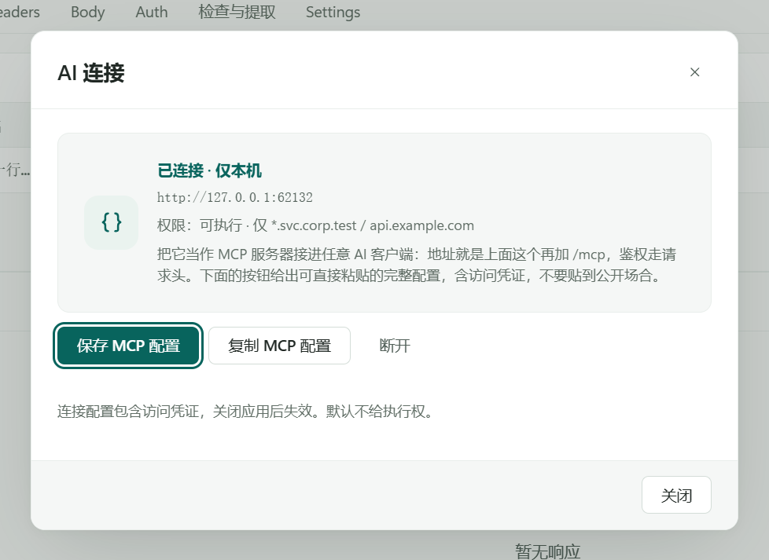

# AI → Relay → 交付

AI 工具可以把接口配置、检查规则和说明写进正在运行的 Relay。用户在应用里看到相同的集合、响应和文档，审阅后确认交付。验证时间与响应样例由 Relay 的真实执行产生。

## 连接

1. 打开 Relay，选择本次验证要用的环境。
2. 点击右上角 **AI**，或进入 **设置 → AI 连接 → 管理连接**。
3. 选择**权限**，点击 **开启 AI 连接 → 复制 MCP 配置**（或**保存 MCP 配置**），把内容交给 AI 工具。
4. 在 AI 工具中加载 `skills/relay-workflow`，描述接口范围、来源和允许验证的环境。

权限分三档，高档包含低档，默认**可编辑**（不含执行权）：

| 权限 | AI 可以做什么 |
| --- | --- |
| 只读 | 查看集合、环境、文档与任务结果 |
| 可编辑 | 另可创建和修改请求、环境、文档与运行计划，并导出 |
| 可执行 | 另可真实发送请求、跑文档验证、运行计划 |

选**可执行**时必须填写**允许的主机**（逗号或换行分隔，`*` 开头匹配子域），通常就是当前环境 `baseUrl` 的那个域名。Relay 在变量解析完成、请求真正发出之前校验主机；`document.verify` 与 `runner.execute` 会先整批预检，只要有一个端点越界就整个任务拒绝、一个请求都不发。跟随跳转时**逐跳重新校验**：白名单里的服务返回一个指向别处的 302，Relay 会停在半路并把“重定向目标是未授权主机 X”报回来，而不是带着同一份凭证继续走。超出权限返回 `insufficient_scope`，越界主机返回 `scope`，两者都要你重新开启连接才能继续——AI 拿不到绕过它的办法。

手动点击**发送**不受这条限制，它使用完整权限；只有 AI 连接驱动的执行的白名单才生效。

## 作为 MCP 服务器接入

同一个监听端口同时提供两种协议，装好应用就能用，不需要再装或再启动任何 MCP 服务：

| 端点 | 协议 | 适合谁 |
| --- | --- | --- |
| `POST /v1/command` | Relay 自有信封 | skill、命令行脚本、`relay_client.py` |
| `POST /mcp` | MCP Streamable HTTP（JSON-RPC 2.0） | 任何支持远程 MCP 的客户端 |

`复制 MCP 配置` 给出的就是可直接粘贴的片段：

```json
{
  "mcpServers": {
    "relay": {
      "url": "http://127.0.0.1:54321/mcp",
      "headers": { "Authorization": "Bearer <会话凭证>" }
    }
  }
}
```

地址里的端口和凭证每次开启连接时重新生成，面板只显示地址、不显示凭证，凭证只在你点复制或保存时才出去。

MCP 侧的能力分级和白名单**与 `/v1/command` 完全一致，并且更严一层**：`tools/list` 只回报当前权限够得着的工具，只读连接根本看不到“发送请求”这个按钮；就算客户端跳过 `tools/list` 直接 `tools/call` 一个越权工具，传输层也会把它挡下来，并以工具结果（而不是传输错误）的形式告诉模型该申请哪一档权限。拒绝原因走 Relay 自己的报错文案，模型据此可以自行纠正参数，而不是重试同一个请求。

`GET /mcp` 返回 405：Relay 不主动推送事件流，任务进度由客户端轮询 `job_get`。

连接只监听 `127.0.0.1`，使用随机端口与访问凭证，默认关闭。关闭连接或应用后配置失效，需要重新保存。配置含凭证，不要放进 Git 仓库或交付文件。关闭连接会阻止后续命令；已开始的请求在 Relay 中继续运行，可在断开前主动取消。



## 安装 skill

将 `relay-workflow` 整个目录复制到 AI 工具的 skill 目录。例如 Codex 使用 `%USERPROFILE%\.codex\skills\relay-workflow`；支持 `SKILL.md` 的其他工具按其本地 skill 规则安装。通用工具也可以直接读取 `SKILL.md` 并调用 Python 客户端。需要 Python3，无额外依赖。

```powershell
python skills/relay-workflow/scripts/relay_client.py --config C:/private/relay-connection.json list
python skills/relay-workflow/scripts/relay_client.py --config C:/private/relay-connection.json call --file command.json --wait
```

不用 skill 的客户端走上面那条 MCP 路径即可；两种协议共用同一个端口、同一份凭证、同一套权限与主机限制。

## 完整流程

AI 读取工作区，创建集合和请求，配置断言与变量提取，关联交付文档并补写说明。执行验证后，AI 根据实际字段结构填写字段含义和已知必填规则，再打开文档供用户审阅。用户点击 **确认交付** 后，可以在 Relay 导出 Markdown、HTML 或 OpenAPI。

不知道的规则会保留待确认；检查失败的接口保留真实失败结果。接口配置或环境变化后，已有验证会提示过期。更新现有内容需要匹配当前版本；用户未保存的请求草稿、正在执行的请求会拒绝外部覆盖。

HTTP 自动验证与串行计划已开放；SSE/WS 可创建配置并在应用内调试，自动流式会话控制暂未开放。导出可包含草稿，需核对返回的 `review` 状态。自动化接口不提供任意脚本、文件读取、删除工作区或替用户确认交付的能力。

接口与字段格式见 [API 参考](../skills/relay-workflow/references/api.md)。
